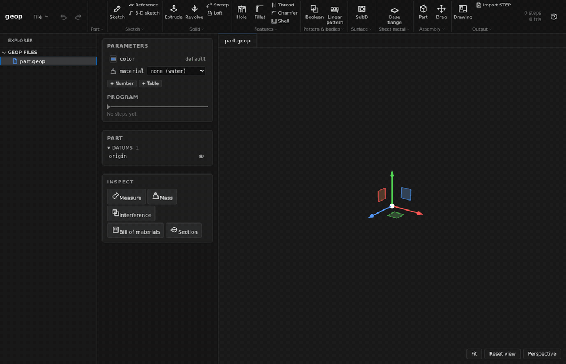

<div align="center">


# geop

**Open-source parametric CAD for designing real machines, on an exact interval-arithmetic NURBS kernel in Rust.**

<a href="https://app.geop-cad.dev"></a>
<a href="docs/mcp.md"></a>
<a href="vscode-extension/README.md"></a>

[](https://github.com/geop-cad/geop/actions/workflows/ci.yml)
[](#license)
[](https://discord.gg/btRDgrcwJ5)
[](https://github.com/geop-cad/geop/stargazers)

[Web app](https://app.geop-cad.dev) · [Website](https://geop-cad.dev) · [Book](https://book.geop-cad.dev) · [API docs](https://docs.geop-cad.dev) · [Roadmap](ROADMAP.md) · [Discord](https://discord.gg/btRDgrcwJ5)

**322 of 361** public STEP corpus files import valid · a drag in a **2000-part** assembly in about **0.25 s** · **no epsilon** decides an answer

<sub>If geop looks useful, a ⭐ on GitHub helps other engineers find it.</sub>



*New part, a rectangle sketched by clicks, extruded, an edge filleted, and the extrusion's distance changed: the fillet follows.*

</div>

## Why geop

- **An exact kernel.** Bodies are NURBS solids, and every number is an interval: comparisons are three-valued, searches subdivide to isolate and Newton to refine, and no epsilon decides an answer.
- **Parts are programs.** A part is an ordered list of steps that refer to what earlier steps built by stable names (`extrude(box,end)`), never by a kernel id, so it rebuilds name for name.
- **One editor, everywhere.** The web app, the VS Code extension, the `geop` CLI and an MCP server for AI agents all drive the same headless editor over one JSON protocol.
- **Built for real machines.** Sketches, features, surfacing, sheet metal, assemblies with joints, drawings, STEP and URDF, scoped by what an engineer needs to design a robot.
- **Open.** Dual-licensed MIT or Apache-2.0.

## Try it

- **In the browser:** [app.geop-cad.dev](https://app.geop-cad.dev). Nothing to install; files stay in your browser. Or open an example straight away: [turbine blade](https://app.geop-cad.dev/?example=turbine_blade), [flange](https://app.geop-cad.dev/?example=cool_flange), [press assembly](https://app.geop-cad.dev/?example=press), [edge part](https://app.geop-cad.dev/?example=edge_part).
- **On the command line:** install `geop` with one line:
  ```sh
  curl -fsSL https://geop-cad.dev/install.sh | sh          # macOS, Linux
  irm https://geop-cad.dev/install.ps1 | iex               # Windows (PowerShell)
  ```
  It downloads the release for your machine, checks its SHA-256 and puts `geop` in `~/.local/bin` (`%LOCALAPPDATA%\geop\bin` on Windows) — no sudo. Or build it from source: `cargo install --path cad/geop-cad-cli` (add `--features frontend` after `npm --prefix web ci && npm --prefix web run build:open` for `geop open`). Then:
  ```sh
  geop open my-project                # edit a folder's .geop files in your browser, on the native kernel
  geop desktop my-project             # the same, in a native window (release builds; from source: --features desktop)
  geop examples --out-dir examples    # every built-in example as a .geop program and its STL
  geop compile part.geop -o part.step
  ```
- **From Claude Code, Codex or any MCP client:**
  ```sh
  claude mcp add geop -- geop mcp   # Claude Code
  codex mcp add geop -- geop mcp    # Codex
  ```
  Then ask for a part: the agent sketches, extrudes, fillets, inspects and exports through the same editor the web app runs. See [docs/mcp.md](docs/mcp.md).
- **As a desktop app:** `geop desktop my-project` opens a folder's `.geop` files in a native window — the same editor as the web app, its kernel in the same process, the view drawn by the GPU (wgpu: Vulkan, Metal, DirectX 12 or OpenGL). From source: `cargo run --release -p geop-cad-desktop -- my-project`. Ctrl+K lists every operation and action; F1 lists the shortcuts.
- **In VS Code:** `geop vscode` installs the extension of your `geop`'s release (into VS Code, Cursor or VSCodium); it opens any `.geop` file as the editor, with the kernel running natively. See [`vscode-extension/`](vscode-extension/README.md).

## Coming from Fusion 360 or Onshape?

The concepts map closely; what differs is that the history is a file you can read, diff and generate.

| You know | In geop |
|---|---|
| Feature tree / timeline | The program: an ordered list of steps, each an operation with its arguments |
| Rolling back the timeline | Seeking back on the program's steps |
| Persistent face and edge references | Stable names such as `extrude(box,end)`, never kernel ids |
| User parameters | Parameters, with operation dimensions as formulas of them |
| Inserting a part into an assembly | `add_part` places another `.geop` file; mates and joints place it |
| Constrained sketches | 2-D sketches with redundant constraints proven and conflicts named |

<sub>Fusion 360 is a trademark of Autodesk, Inc.; Onshape is a trademark of PTC Inc. geop is not affiliated with either.</sub>

## What works

Taken from [ROADMAP.md](ROADMAP.md), which also says what is next.

**Sketching**
- 2-D constraint sketches with slots, polygons, fillets, offsets, mirrors and patterns; redundant constraints proven and conflicts named.
- 3-D sketches as wires; exact helices.

**Part features**
- Extrude, revolve, sweep (with rails and twist) and loft; parameters as formulas.
- Holes from ISO tables, cosmetic and modelled threads.
- Rolling-ball fillets on any edge with variable radius and rounded corners; chamfers.
- Shell, rib, lip and groove, draft; linear and circular patterns and mirrors of bodies and features.

**Surfacing**
- Ruled, boundary, N-sided and Gordon (UV) surfaces; offset, thicken, knit, trim and extend.
- Catmull–Clark subdivision surfaces converted to valid NURBS solids.

**Sheet metal**
- Base and edge flanges, hems, corners, cuts across bends; exact flat patterns as DXF.

**Assemblies**
- Multi-file assemblies placed by mates; revolute, slider, cylindrical, planar, pin-in-slot, ball, universal and fastened joints with limits; tangent (cam and follower) and path mates; gear, belt, rack-and-pinion, screw and linear couplings; exploded views; motion studies played, checked for collisions and exported.
- Standard parts: ISO fasteners, bearings, extrusions, steppers, gears, pulleys, rails, servos.
- Wire harnesses with bend radii and cut lengths.
- A drag in 2000 parts in about 0.25 s.

**Inspection and output**
- Measure, mass properties from the exact B-rep, interference, section views; bills of materials.
- Drawings with hidden lines, sections, dimensions and balloons as SVG and DXF.
- STEP AP214 import and export (322 of 361 public corpus files import valid); URDF for robot simulators; STL.

**Front ends**
- The web app, the VS Code extension, the `geop` CLI and the MCP server all drive one headless editor over one JSON protocol.

## How it is built

- Every number is an interval: comparisons are three-valued (`definitely`, `could be`), searches subdivide to isolate and Newton to refine, and no epsilon decides an answer. [AGENTS.md](AGENTS.md) records the rules and the bugs that made them.
- A part is a *program*: an ordered list of steps, each an operation with its arguments, referring to what earlier steps built by stable names (`extrude(box,end)` is the end cap of the step `box`), never by a kernel id, so it rebuilds the same part name for name.
- The workspace has four tiers: `core/` (math, NURBS, the B-rep, programs, the editor), `lib/` (algorithms two operations share), `ops/` (one crate per family of operations, each with its forms, examples and tests) and `cad/` (the composition, one `register` line per crate, carried to the browser, the desktop app, the command line and MCP).
- The [book](https://book.geop-cad.dev) tours the crates; [docs.geop-cad.dev](https://docs.geop-cad.dev) is the rustdoc; [DEVELOPERS.md](DEVELOPERS.md) has the crate table, scripts and conventions.
- The landing page is [geop-cad.dev](https://geop-cad.dev).

<details>
<summary>A program, as it is saved</summary>

```json
{
  "steps": [
    { "id": "outline", "operation": "add_sketch",
      "args": { "plane": { "datum": "origin:xy" },
                "sketch": { "points": { ... }, "curves": { ... }, "constraints": { ... } } } },
    { "id": "box", "operation": "extrude",
      "args": { "sketch": { "target": "/:sketch:outline" },
                "extent": { "side1": { "blind": 1.0 }, "symmetric": false, "reversed": false },
                "output": { "solid": { "mode": "new_body" } } } },
    { "id": "hole_sketch", "operation": "add_sketch",
      "args": { "plane": { "face": "extrude(box,end)" }, "sketch": { ... } } },
    { "id": "hole", "operation": "extrude",
      "args": { "sketch": { "target": "/:sketch:hole_sketch" },
                "extent": { "side1": { "blind": -0.5 }, "symmetric": false, "reversed": false },
                "output": { "solid": { "mode": "with", "op": "difference", "target": "extrude(box)" } } } }
  ]
}
```

Whatever a step builds on is named: a face as `{"face": "extrude(box,end)"}`,
an edge to blend by its name in the step's `edges`, a
sketch another step drew as `{"target": "/:sketch:<id>"}`. Every part starts
with the datum `origin`; its planes are `{"datum": "origin:xy"}`, `origin:yz`
and `origin:zx`. A program places the parts other files build
with `add_part` and mates their entities (`pin/extrude(pin,start)`); where
each placed part is, is the program's `state`, solved after every edit.
`geop compile assembly.geop` reads the placed files next to it.
</details>

## Contributing

Issues and pull requests are welcome; see [CONTRIBUTING.md](CONTRIBUTING.md)
for how the code is laid out and tested, and come talk on
[Discord](https://discord.gg/btRDgrcwJ5).

## Sponsoring

If geop is useful to you, consider [sponsoring on Ko-fi](https://ko-fi.com/tobiasjacob):
it funds the time that goes into the kernel.

## License

Dual-licensed under [MIT](LICENSE-MIT) or [Apache-2.0](LICENSE-APACHE), at
your option. The code is provided as is, with no warranty of any kind.
Unless you state otherwise, a contribution you submit is licensed the same
way, with no further terms.
