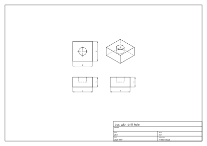
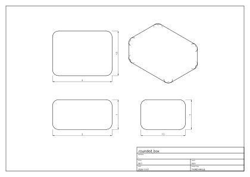

# Lecture 35: STEP and drawings

<div class="goals">

**After this lecture you can**

- read a STEP file's structure, follow it from a solid down to a point, and say how its model differs from Geop's;
- explain how an importer turns analytic surfaces into NURBS, what it does with seams, and how it treats the disagreement a real file contains;
- state the three-step hidden-line algorithm, and why one ray per piece is enough;
- define a silhouette and trace it;
- say why the rasterizer is the one place in the kernel allowed to sample, what it must still get right, and what two traps it fell into.

</div>

A kernel is not done when it can build a shape. It has to take shapes in from other systems, and it has to put them out in forms people use: a drawing for a machinist, a mesh for a printer or a screen. All three of those are translations between what the kernel knows, and formats that know less or differently. This lecture is about what such a translation keeps, and what it must be honest about losing.

## STEP

**STEP** (ISO 10303) is the standard neutral format for exchanging B-reps. A file is plain text in the encoding of Part 21: a header, then a data section of numbered entity instances. An **application protocol** says which entities are meaningful: AP203, AP214 and AP242 are the ones you meet for mechanical parts, and they share the B-rep geometry.

Here is the top of a real file, written by the kernel: `geop compile` of the example `rounded_box`, to `.step`, with most lines elided as `...`.

```text
ISO-10303-21;
HEADER;
FILE_DESCRIPTION(('rounded_box'),'2;1');
FILE_NAME('rounded_box.step','',(''),(''),'geop','geop','');
FILE_SCHEMA(('AUTOMOTIVE_DESIGN { 1 0 10303 214 1 1 1 1 }'));
ENDSEC;
DATA;
#1=APPLICATION_CONTEXT('core data for automotive mechanical design processes');
...
#3=(LENGTH_UNIT() NAMED_UNIT(*) SI_UNIT(.MILLI.,.METRE.));
...
#6=UNCERTAINTY_MEASURE_WITH_UNIT(LENGTH_MEASURE(1.E-7),#3,'distance_accuracy_value','confusion accuracy');
...
#8=CARTESIAN_POINT('',(0.2,0.2,-2.7755575615628914E-17));
...
#688=CLOSED_SHELL('',(#47,#87,#125,...));
#689=MANIFOLD_SOLID_BREP('fillet(round)',#688);
```

The entities form a graph by `#` reference. From the solid down:

```text
MANIFOLD_SOLID_BREP → CLOSED_SHELL → ADVANCED_FACE → FACE_OUTER_BOUND → EDGE_LOOP
   → ORIENTED_EDGE → EDGE_CURVE → VERTEX_POINT → CARTESIAN_POINT
                         ↳ the edge's curve        ADVANCED_FACE ↳ its surface
```

That maps almost one to one onto [Lecture 17](./17-brep.md)'s model: `ORIENTED_EDGE` is a coedge, `EDGE_CURVE` an edge. The file above has 26 `ADVANCED_FACE`s, 48 `EDGE_CURVE`s and 24 `VERTEX_POINT`s, and `$24-48+26=2$`, as Euler requires for a solid with no holes. (6 flat faces, 12 fillets, 8 corner patches.) Look at what is not there: a **pcurve**. A STEP edge has a 3-D curve and may or may not have pcurves (`SURFACE_CURVE`, in the larger entity set). Geop requires them for every coedge, so the importer has to make them.

A complex instance such as `#3=(LENGTH_UNIT() NAMED_UNIT(*) SI_UNIT(...))` is a single instance of several entity types at once. `ops/geop-ops-step/src/part21.rs` reads the encoding and knows nothing of what the entities mean; meaning belongs to `ops/geop-ops-step/src/import/` and `ops/geop-ops-step/src/export.rs`.

### Reading: three differences to bridge

`import/structure.rs` finds the bodies: every `MANIFOLD_SOLID_BREP`, `BREP_WITH_VOIDS` and `SHELL_BASED_SURFACE_MODEL`, with their units, and in an assembly walks down from the products nothing places, composing placements (through `NEXT_ASSEMBLY_USAGE_OCCURRENCE` and `ITEM_DEFINED_TRANSFORMATION`) into one per body. `import/geometry.rs` reads curves and surfaces. `import/body.rs`, at 3700 lines the largest file of the crate, reads the topology. Its opening comment lists the three ways a STEP B-rep and a Geop one differ.

**Everything becomes NURBS.** A file has `PLANE`, `CYLINDRICAL_SURFACE`, `CONICAL_SURFACE`, `SPHERICAL_SURFACE`, `TOROIDAL_SURFACE`, `SURFACE_OF_REVOLUTION`, `SURFACE_OF_LINEAR_EXTRUSION`, `B_SPLINE_SURFACE`, and `LINE`, `CIRCLE`, `ELLIPSE`. Each analytic type is built as an *exact* NURBS covering its face ([Lecture 8](./08-nurbs.md)), and a B-spline is taken as it is. The kernel's "no branch on surface kinds" begins where the data comes in: this importer's dispatch on the entity's type is the only place the type matters, and it vanishes right after.

The file is read into plain `f64` definitions (`CurveDef`, `SurfaceDef`), used for decisions such as where a face wraps and which loop is outer: "it is data, decided on before anything exact is built from it".

**Periodic surfaces.** STEP parametrizes a cylinder all the way round, so a face going round its axis runs along a **seam**, one edge its loop uses twice, or is bounded by loops that go once round each. A Geop surface is a patch that does not wrap: its loops close in `$(u,v)$` ([Lecture 18](./18-poles-seams-splicing.md)). So a wrapping face is cut along meridians into sectors, each on a patch of its own: `Builder::cut_wrapping_face`. A face going round a torus's tube is cut along parallels (`Builder::cut_tube_wrapping_face`), and a whole torus into bands first (`Builder::cut_whole_torus`). A thread's flank, which turns more than once without going round, is cut along meridians too (`Builder::cut_helical_face`). The operation's doc names the new pieces (`fN,qM` and so on), so a later step can refer to them.

**Closed edges.** A STEP edge may start and end at one vertex, a whole circle. A Geop edge may not, so it is split in two.

Then every pcurve is fitted by projecting the edge onto the surface, by `NurbSurface::fit_pcurve` ([Lecture 16](./16-tracing-and-pcurves.md)), the way all pcurves of the kernel are.

### Reading: tolerance

A file's numbers do not agree with each other. A vertex's `CARTESIAN_POINT`, the ends of its edges' curves, and the surfaces it should lie on, each say something slightly different, and the file's `UNCERTAINTY_MEASURE_WITH_UNIT` says by how much that is allowed. A kernel can read a tolerance from the file and carry it beside the geometry. In Geop, *every value already is an enclosure*, so a file's disagreement has somewhere natural to go.

**A vertex is the union of every place the file says it is:** its point, the ends of its edges' curves, and its foot points on its faces' surfaces. Union, because these are enclosures of one point that disagree, and the rule of [Lecture 5](./05-honest-numerics.md) is to cover both. Its width is then an honest measure of how much the file disagrees with itself.

**An edge is widened** until it reaches the midpoints of its pcurve's points on each of its faces, measured and widened in rounds: the first round by the file's disagreement, later ones by rounding. There is a nice piece of honesty in that loop. Widening by exactly the gap left falls short by a rounding, and a comment records it: an edge `4.4e-16` off a plane "was widened four times and ended `6.7e-80` short of it". So later rounds widen by twice the gap, and the comment says this is "a workaround, kept knowingly", giving what the fix would be.

**What lies further apart than the kernel can carry is rebuilt.** The limit is `ACCURACY`, `1e-4`: the widest a vertex or a control point may be ([Lecture 20](./20-validation.md)). Past that, `heal` rebuilds from the surfaces, since a B-rep is defined by them: a vertex where its faces' surfaces meet, an edge along where they meet. Where the surfaces themselves contradict each other, the smallest faces there are left out, and rebuilt from their edges (`rebuilt_surface`). The file's uncertainty bounds this: what is rebuilt must lie on its surfaces to within it, and what cannot be is refused by name, as is anything that would move further than half the length of an edge there. What was rebuilt is reported as a `Healing`, with how far each thing moved, and shown to the user: a list of what the kernel changed, not a silent fix.

### A trap at the last bit

[Lecture 11](./11-evaluate-locally.md) explains why curves evaluate relative to a control point of the span. A STEP file showed the other side of it. An edge lay `2e-31` above its plane face (AGENTS.md, *Evaluate relative to the patch*). Evaluated relative to a control point `1.8e-15` up, its enclosure took in the plane, because the relative evaluation adds that point back with one rounding, and an ulp at `1.8e-15` is about `4e-31`. So the importer measured no gap and did not widen the edge. Validation's clipping, which reads control points, found the face's points off it.

Neither computation was wrong. Each is a true enclosure, and each is the tighter one somewhere. So `NurbCurve::evaluate` (`core/geop-core-geometry/src/nurb_curve/evaluate.rs`) computes both, absolute and relative, and `intersect`s them. Two enclosures of one value with different numerical strengths: their intersection is still a true enclosure. That rule is from [Lecture 5](./05-honest-numerics.md), and it took a real file's `2e-31` to need it.

### Writing, and the corpus

Writing is far simpler (`ops/geop-ops-step/src/export.rs`, `write_step`, `write_part`): each solid a `MANIFOLD_SOLID_BREP`, each sheet a `SHELL_BASED_SURFACE_MODEL`, every surface and curve "written exactly as the kernel holds it: a `B_SPLINE_*_WITH_KNOTS`, rational where a weight is not one". The file above reflects this: it holds not one `CYLINDRICAL_SURFACE`. Another system receives correct B-splines, not recognisable primitives; a cylinder comes back as a spline to it. Values are written as interval midpoints: a format with no enclosures can only hold a number. Names of entities are the part's own (`'fillet(round)'` above). An assembly becomes products and occurrences.

Testing an importer against files you made yourself proves little, since real files come from other kernels' idiosyncrasies. `ops/geop-ops-step/scripts/fetch_corpus.sh` downloads public files, the NIST MBE PMI test models, STEP files from the OCCT, CadQuery and build123d repositories, and a spread of the FreeCAD parts library, into `target/step-corpus/`, never committed. The ignored test `corpus` (`ops/geop-ops-step/src/corpus.rs`) imports them all, validates them, and prints a table of what passed and why the rest failed, with `STEP_CORPUS_ONLY` and `STEP_CORPUS_FULL` to narrow or deepen it. We did not run it for this book, so no pass rate is quoted here.

### STL

The other way in is a mesh. `ImportStl` (`ops/geop-ops-step/src/stl.rs`) reads either form of STL, makes each triangle a face with `BodySpec::of_triangles`, and merges coplanar triangles into one face with `BodySpec::merged`. A solid if every edge is shared by two triangles, a sheet otherwise. A mesh has no curved surfaces to recover, and it does not try to.

## Drawings

An engineering drawing is a set of 2-D projections with visible lines solid and hidden lines dashed, on a sheet, with dimensions and a title block. It was the original CAD output, and it remains a contract: a machinist builds what the drawing says.

The following is a real sheet, written by the kernel with `geop compile box_with_drill_hole.geop -o box_with_drill_hole.svg`. In third-angle layout: the top view above the front view, the right view beside it, an isometric view at the upper right. The blind hole's wall and floor are dashed wherever material hides them.



The crate is `ops/geop-ops-drawing`. Views come from `ops/geop-ops-drawing/src/view.rs`: "the views are the usual ones of a `z`-up modeller". Let us look at how such lines are found.

### Hidden-line removal in three steps

What should a view draw? Edges where faces meet at an angle (tangent edges only if asked), and the **silhouettes** of curved faces. Along such a curve, what is in front of it changes only where its projection meets the projection of another curve, passing behind an edge or a silhouette, or where it turns back on itself. That one observation gives the algorithm (`project_view` in `ops/geop-ops-drawing/src/hidden_lines.rs`):

1. **Project every curve, exactly.** Orthographic projection is linear, so a NURBS curve projects to a NURBS curve with the same knots and weights (`ViewFrame::project_curve`).
2. **Cut each one** wherever its projection crosses or runs along another's (`curve_curve_overlaps_and_crossings`), and wherever it is stationary along the paper's axes (`NurbCurve::stationary_parameters`), which holds every point where it turns back.
3. **One point decides a piece.** Between cuts, nothing in front of it can change, so a ray from one point towards the eye gives the answer for the whole piece. If it crosses a face first, the piece is hidden.

This is sound, not a heuristic: step 2 removes every place where visibility could change. Look at what step 3 is doing in the context of "Do not decide from samples": it takes one sample because the structure has *proved* the answer is constant along the piece. (That is the same shape of argument as [Lecture 19](./19-classification.md) with faces and rays, and as a classification after remesh, [Lecture 22](./22-boolean.md).)

Three subtleties, all in `seen`:

- A crossing at the ray's own start is no crossing: the point lies on the faces it bounds.
- A crossing *on a face's trim boundary* means an edge is in front. The piece runs along that edge on the paper. So it is classified hidden, and a later pass (`drop_drawn`) drops it along with every piece lying on one already drawn. A hidden line under a visible one is never drawn, nor any line twice.
- A ray running *in* a face's surface is seen edge-on, and "an edge-on face hides nothing": `curve_surface_overlaps` catches it first.

<figure class="demo" data-demo="hidden-lines">
<figcaption>Drag to turn the scene. Solid: visible; dashed: hidden; blue: silhouettes of the cylinder, which appear wherever you look from. "Cuts" shows where step 2 cut. These are the three steps above on simplified input: convex solids, straight segments (a circle as 64 of them), and floats with a small tolerance where the kernel uses enclosures and full ray tests against trimmed faces.</figcaption>
</figure>

### Silhouettes

A cylinder seen from the side has two straight lines that are no edge. They are where the surface turns away from the eye. For a view along `$d$`, a point of the surface is on the silhouette when the normal is square to `$d$`:

`$$g(u,v)=\bigl(S_u(u,v)\times S_v(u,v)\bigr)\cdot d=0.$$`

This is a curve in `$(u,v)$`, and the kernel's method (`ops/geop-ops-drawing/src/silhouette.rs`) is the one you know for an intersection ([Lecture 16](./16-tracing-and-pcurves.md)): a seed, then predictor-corrector steps along the tangent `$(-g_v,g_u)$`, then Newton back onto `$g=0$`.

Where do seeds come from? `$g$`'s sign is sampled along a grid of iso lines, with bisection between opposite signs. Is this a sample deciding an answer, against our rule? The comment is careful: "Sampling only decides where to look: what is traced is the exact zero set". What could it miss, though? A closed loop crossing no grid line lies within one cell, and encloses a critical point of `$g$`, so each cell where `$g$` could vanish is halved into boxes, those that could hold a critical point halved again, and a line through each is sampled too (`loop_seats`). The grid's interior lines sit at irrational fractions of the domain, a free choice so they do not run along the symmetric iso lines silhouettes so often are.

Then each piece is trimmed against the face and fitted as a 3-D curve through exact silhouette points, widened to enclose what lies between (`NurbCurve3D::fit_enclosing`). The visibility test needs a point exactly on it, so it asks `Silhouette::exact_point`, since a ray grazing a face at its silhouette tells the truth only from the exact point.

### A case: the duck's ankle

A recent commit to this code (`c0c70bb4`) is a compact lesson in "Name the entities before you name the cause", from AGENTS.md. Here is what its message records. The duck assembly, updated, did not draw from the right. A vague explanation is easy to imagine: a numerically awkward view. What it named instead: face 37 of the left ankle, the lower quarter cylinder of its D-shaped profile, extruded 15 along `$x$`; degree 1 along `$x$`, a rational quadratic round the arc. In the ankle's frame, the right view looks along `$(-1,-8.1\times10^{-15},3.9\times10^{-14})$`: `4e-14` off the cylinder's axis.

So `$g$` was a rounding off zero *all over the face*. Is a silhouette there? Asked to the last bit, the check `swept_along` said this face is not swept along the view, and the tracer started. Its corrector returned the seed on the start edge at `$v=[-50.8,105.5]$`, in a domain of `$[0,1]$`: honest for a `$g$` that noisy, but reaching past the domain, and the march then evaluated the arc there, where its weight could be zero.

Two fixes, each of which alone draws the duck. First, the question is asked at the right resolution. A drawing's resolution is the sheet's (`COARSE_SUBDIVISION`), and `swept_along` now decides to it: every control point of a row, of one weight, within it on the paper of the row's first. The face then lies within it of the curve its first points span, which its edges draw, and so do its silhouettes. A generator seen `4e-14` off its length projects to a point. Second, the corrector cuts its answer to the domain: the silhouette sought is on the patch, and an interval argument is no licence to evaluate past it. The reproducer is `quarter_cylinder_seen_a_hair_off_its_axis`, which rebuilds face 37 from its enclosures.

Is the coarse decision an epsilon? It comes close to the line, so here is the reasoning as this book reads it. It does not decide whether a value of the geometry is zero; it decides whether a *drawing*, whose output is ink on paper, can see the difference, and the fallback when it says no is the edges, which draw the same ink. Compare `is_point` and the "sheet's resolution" handoffs in `seen`. What must not depend on such a threshold is a claim about the geometry itself.

### Assemblies, sections, and the sheet

An assembly places the same part a hundred times, and `ops/geop-ops-drawing/src/scene.rs` is built round that fact.

1. **Each part on its own**: a part's lines and which of them its own faces hide, from a direction turned into its own frame. Placed parts of one component turned alike share this work.
2. **The parts together** (`Scene::together`): each line a part shows is cut where it crosses a line another part shows, each piece decided by a ray against that part's faces.
3. **Copies behind copies** (`Scene::mark_copies_behind`): a copy exactly behind another adds no line, so a row of screws seen end on is drawn as one.

A stated limit: "A line is not cut where it enters another part, only where it passes behind its outline: parts that pierce each other are a known limit."

A **section** view takes what lies on one side of a plane away, by the kernel's own boolean: subtract a box standing on the plane from every solid (`section_part` in `ops/geop-ops-drawing/src/section.rs`); `cut_faces` finds what to hatch. No section code runs on its own: a section is a boolean plus the views above.

Then `ops/geop-ops-drawing/src/drawing.rs` composes: views laid out in third- or first-angle projection, centre marks on circles, overall sizes dimensioned, a border, a title block, and a parts list with balloons if asked for. An `Annotation` (a `Distance`, a `Radius` ...) refers to what it measures *by the entities' names and the view's*, and its value is measured anew at each rebuild. "A drawing changes nothing, it only annotates." It follows the part through every edit because it names things rather than storing positions.

Finally `lib/geop-lib-sheet` holds plain strokes and labels on layers, written by `to_svg` or `to_dxf`. Curves become lines, arcs and circles where they *are* those (`NurbCurve3D::as_line`, `NurbCurve3D::as_arc`), else polylines through points. This is one of the places "Where a user needs the exact line or arc back, as a sketch projecting an edge does, it is reconstructed locally where it is used" from AGENTS.md: the kernel holds a NURBS, and the DXF reader gets a true `ARC`.

The flat pattern's DXF of [Lecture 33](./33-sheet-metal-plastic.md) goes out the same way.

Here is a second real sheet, of `rounded_box`. Every outline in it is a silhouette: the fillets meet the flat faces tangentially, so the tangent edges are not drawn, and in the isometric view you can see the short silhouette arcs of the ball patches at the corners.



## Meshes: the one place that samples

A screen and a 3-D printer want triangles. `core/geop-core-rasterize` turns a model into sampled geometry: a point per vertex, a polyline per edge, triangles per face, each tagged with the entity it came from, for drawing, picking, STL and debugging.

"Do not decide from samples" names this crate as its exception: "what it draws is a polygon, so sampling is what it is for". So it is in plain `f64`, and its quality is a parameter that decides nothing but appearance. Being allowed to sample does not make it easy, though. The problems are combinatorial, not numeric.

The method (`triangulate_face`, `core/geop-core-rasterize/src/grid.rs`):

1. Every edge is sampled once (`sample_curve`), curvature-sized, and a face's boundaries are placed in its `$(u,v)$` from those samples, so two faces share exactly the same boundary points.
2. Pick a uniform `$(u,v)$` grid: start from some `$n$` and double until every cell's flat approximation is within a curvature tolerance. A flat patch stays coarse, a curved one gets what it needs.
3. Split the outer boundary and each hole into convex parts, clip each to grid cells (`clip_to_rect`), subtract the holes' parts in each cell (`subtract_convex`), and ear-clip what is left (`ear_clip`).

The module comment records three earlier versions that were wrong, a history worth reading: a slit from outer loop to hole that a cell boundary could cross; the same slit done per cell, with a visibility heuristic that could choose a wrong bridge; and clipping a concave outer boundary directly, which returned two pieces joined by a zero-width bridge, so that "a face whose trim went around a hole was drawn across it". The version that stuck has no bridge to get wrong. A convex region is the intersection of its edges' half planes, so its complement is the union of their outsides: peel off each outside part in turn.

### Two traps

**A mesh that ate the machine.** AGENTS.md opens its rule "Cap every run's memory and time" with this. A revolve that "crashed the boolean" was in fact the rasterizer: clipping a concave hole of many corners split it into exponentially many pieces, since `subtract_convex` kept degenerate leftovers. A concave hole is taken out as many triangles, one after another, and cutting every piece along every triangle's sides *whether it overlaps or not* multiplies the pieces with each triangle. The fix is one test: if the leftover inside the hole is empty, the hole does not overlap the subject, and the subject is returned whole. Only interrupting a capped run under `gdb` showed where it was. The failure surfaced far from its cause, and looking only at the boolean would have found nothing.

**A volume that weighed slivers.** A closed mesh's volume is `$\sum_T\tfrac16\,a\cdot(b\times c)$`, a sum of signed tetrahedra from the origin, by the divergence theorem. Each face was once sampled alone, so two faces met along a curved edge in two polygons a sliver apart: the mesh was not closed. The sum is exact only for a closed figure. Taken from the origin, those slivers were weighted by their distance from it: in a plate at `$(10000,-5000,2000)$`, AGENTS.md reports 5.5 of error for a bore of 142.

Two fixes, at two levels. `enclosed_volume` (`core/geop-core-rasterize/src/stl.rs`) takes its apex at a corner of the mesh, so "what is not closed weighs by its size". And the mesh itself is now closed: `core/geop-core-rasterize/src/mesh.rs` makes it conforming, within a face (`Mesh::conform`) and across an edge (`zip`), every point any face put on an edge being put on it in every face that edge bounds, bit for bit. "An STL of a solid is a closed mesh." Note that the mesh's closure is combinatorial, enforced by construction, not by chance agreement of floats.

Note where exact volume comes from: not this mesh at all. Mass properties integrate the NURBS directly, by Green's theorem, in `core/geop-core-topology/src/mass.rs` ([Lecture 41](./41-performance.md)). A mesh is for looking at.

<div class="recap">

## Recap

- STEP is a graph of entities mapping nearly one to one onto a B-rep, without required pcurves, with periodic surfaces and closed edges a Geop patch cannot have. Import makes exact NURBS, cuts wrapping faces, and fits pcurves.
- A file's disagreement becomes enclosure width: union for a vertex, widening for an edge. Past `1e-4`, it heals from the surfaces, or refuses by name; what it healed is reported.
- Export writes B-splines exactly, midpoints of intervals. A corpus of real files tests the importer; no pass rate is claimed here.
- Hidden lines: project exactly, cut at crossings and turning points, decide each piece with one ray. A silhouette is the zero set of `$(S_u\times S_v)\cdot d$`, traced like an intersection.
- Decide at the output's resolution where the output cannot see the difference: `swept_along` to the sheet's.
- The rasterizer may sample since a polygon is what it draws. Its hard problems are combinatorial: runaway piece counts, and a mesh that must close.

</div>

## Exercises

**1.** Verify Euler's formula for the `rounded_box` STEP counts given above. Then predict `$F,E,V$` for a box with one fillet on one edge, and for the same box with a through hole. (For a solid with one hole through it, `$V-E+F=2-2g$` with `$g$` the genus: but also note Geop requires a face with a hole to have two loops, so the formula needs the number of loops `$L$`.)

<details class="solution"><summary>Solution</summary>

`$24-48+26=2$`. One fillet on one edge of a box: the fillet adds one face, and splits the edge into two, with the two end vertices each becoming two: `$F=7,E=15,V=10$`, and `$10-15+7=2$`. A through hole: the general form is `$V-E+F-(L-F)=2(1-g)$`, where `$L$` is the number of loops. For example, a plain box with a square through hole has `$V=16,E=24,F=10,L=12,g=1$`: `$16-24+10-2=0$`.

</details>

**2.** A file has a vertex whose point is `$(1,0,0)$`, an edge end at `$(1+2\times10^{-7},0,0)$`, and a foot on a surface at `$(1-10^{-7},0,0)$`. What enclosure does the importer build for the first coordinate, and what is its width? Is it accepted? How would your answer change if the edge end were at `$1+3\times10^{-4}$`?

<details class="solution"><summary>Solution</summary>

The union: `$[1-10^{-7},1+2\times10^{-7}]$`, widened by rounding, of width `$3\times10^{-7}$`. That is far under `ACCURACY`, `$10^{-4}$`, so it is kept. At `$1+3\times10^{-4}$` the places lie further apart than the kernel can carry as one point, so `heal` rebuilds the vertex where its faces' surfaces meet, if they meet within the file's uncertainty near it, and reports how far it moved in a `Healing`. If they do not, it either leaves out the smallest faces and rebuilds them from their edges, or refuses by name.

</details>

**3.** In the hidden-line demo, choose "one box" and turn it to any general view. Count visible and hidden edges. Show that a convex polyhedron seen from a general direction shows an edge if and only if at least one adjacent face is front-facing. Why does the algorithm in the demo not need that rule, and what would it miss if it used only that?

<details class="solution"><summary>Solution</summary>

A box shows 9 and hides 3 from a general corner view. For a convex solid a point on a front-facing face has nothing in front of it: the solid lies entirely behind the face's plane. An edge between two back-facing faces lies behind them. The rule is special to convex solids and to a solid hiding itself alone: with two solids, or with a non-convex part, a front-facing face can still be behind something. The ray from each piece asks about everything in front, so it needs no such rule, and it is correct for the general case once cuts are in the right places.

</details>

**4.** Why must a curve be cut where its projection is stationary along the paper's axes? Give an example of a curve that is seen wrongly if you cut only at crossings with other curves.

<details class="solution"><summary>Hint</summary>

The module comment says it: a turn-back is where a curve runs along the line of sight. A planar arc seen nearly edge-on projects to a line traversed twice. Without a cut at the turn, one piece covers both directions, one visible and one hidden, with no crossing between them. The stationary points also leave every piece monotone along both axes, which the module uses for other purposes.

</details>

**5.** Find `$g(u,v)$` for a cylinder of radius `$R$` about the `$z$` axis, with `$S(u,v)=(R\cos u,R\sin u,v)$`, viewed along `$d=(d_x,d_y,d_z)$`. Where is the silhouette? What happens as `$d\to(0,0,1)$`, and how does this relate to the duck's ankle?

<details class="solution"><summary>Solution</summary>

`$S_u\times S_v=(R\cos u,R\sin u,0)$`, so `$g=R(d_x\cos u+d_y\sin u)$`, zero at `$u=\operatorname{atan2}(d_y,d_x)\pm\pi/2$`: two generators. As `$d$` approaches the axis, `$(d_x,d_y)\to0$`, and `$g$` tends to zero *everywhere*: every point is a silhouette, and each generator projects to a point. In the limit the whole lateral face has no silhouette to draw, only its end circles. When `$(d_x,d_y)\approx4\times10^{-14}$`, `$g$` is rounding, as on the ankle. That is why `swept_along` has to recognize the case rather than trace `$g$`.

</details>

**6.** Suppose a mesh is not closed: there is a gap along a curved edge of length `$\ell$` and width `$\epsilon$`. Estimate the volume error of the tetrahedra sum from an apex at distance `$D$`. Now take the numbers in the text, and check that `$D\approx10^4$` and a sliver of area `$\sim10^{-3}$` give the right order of error.

<details class="solution"><summary>Solution</summary>

The sum over a closed mesh is independent of its apex. A mesh with a hole of (vector) area `$A$` adds an apex-dependent term `$\tfrac13D\,A$` in magnitude: a missing face's own tetrahedron. With `$A=\ell\epsilon$`, `$D\sim1.1\times10^4$`, the error is about `$3700\,\ell\epsilon$`, and 5.5 corresponds to `$\ell\epsilon\sim1.5\times10^{-3}$`, plausibly a rim's length of 40 by a sliver of `$4\times10^{-5}$`. These sliver numbers are an estimate, not measured. Placing the apex on the mesh makes `$D$` the part's own size, reducing the error to `$\sim80/1.1\times10^{4}$` of that.

</details>
